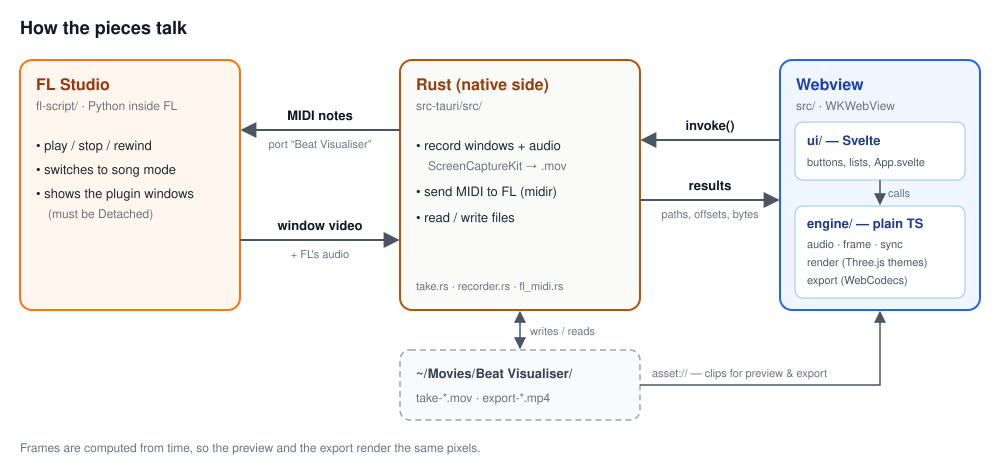

# Developer guide

How the Beat Visualiser repo fits together, what happens when you press the main button, and where to work. For product goals, design principles and architecture decisions, see [CLAUDE.md](CLAUDE.md).

Status: the full workflow works on **macOS** for one beat. Windows (the OS) is not started yet.

## 1. Three programs that talk to each other



The diagram is a hand-written SVG ([docs/architecture.svg](docs/architecture.svg)); edit it as text when the architecture changes.

- **FL script** (Python, runs inside FL): about 100 lines that turn MIDI notes into transport commands.
- **Rust** ([src-tauri/](src-tauri/)): handles everything the browser isn't allowed to do: window capture, MIDI and the file system. The frontend calls it with `invoke('command_name', args)`; on the Rust side that's a `#[tauri::command]` function, registered in [lib.rs](src-tauri/src/lib.rs).
- **Webview** ([src/](src/)): everything else. `ui/` is the Svelte interface. `engine/` is plain TypeScript and **never imports Svelte** (ESLint enforces this).

## 2. What happens on one button press

This is the core of the app; read the files in this order.

1. **Drop a beat.**
   - [DropZone.svelte](src/ui/DropZone.svelte) gets the file path from Tauri's drag-and-drop event.
   - Rust [audio_file.rs](src-tauri/src/audio_file.rs) returns the file's bytes.
   - [decode.ts](src/engine/audio/decode.ts) turns them into an `AudioBuffer`: raw float samples, at the audio context's sample rate.
   - [analysis/](src/engine/analysis/) scores every 50 ms of the beat (loudness, bass, spectral flux) and picks the strongest 15/30/60 s, away from the intro and outro. With the BPM the user types, the section is a whole number of bars (multiple of 4) and starts on a bar; it can be dragged on the waveform.
2. **Pick plugin windows.** "List windows" calls [window_list.rs](src-tauri/src/window_list.rs), which asks macOS (ScreenCaptureKit) for every window with its title and app. The user clicks 1–3 rows; the order is top → bottom.
3. **Press "Play & record".** This calls `record_take` in [take.rs](src-tauri/src/take.rs), the most important Rust file:
   1. Check everything: permission, the windows exist and are on screen, the MIDI port works.
   2. Send FL **stop**, then **jump** to the section start. The script also switches FL to song mode.
   3. Start recording every window with [recorder.rs](src-tauri/src/recorder.rs). Each one becomes an HEVC `.mov` in `~/Movies/Beat Visualiser/`, including FL's audio.
   4. Send **play** once and note when, per clip (`play_offset`).
   5. Wait for the chosen length, send **stop**, close the files. FL always gets stop, even after an error.
4. **Sync.** [sync-take.ts](src/engine/sync/sync-take.ts) reads each recording's audio, and [align.ts](src/engine/sync/align.ts) **cross-correlates** it with the beat file. The result is each clip's exact `offset`: the video time at which beat time 0 happens. If the match is weak, the timing estimate (`play_offset`) is used instead.
5. **Preview.** [Preview.svelte](src/ui/Preview.svelte) runs a `requestAnimationFrame` loop. Each frame it:
   1. reads the player time ([player.ts](src/engine/audio/player.ts));
   2. computes `FrameData` for that time ([frame-data.ts](src/engine/frame/frame-data.ts): waveform peaks, loudness, bass);
   3. keeps each plugin video in sync ([plugin-clip.ts](src/engine/video/plugin-clip.ts));
   4. calls `theme.render(frame, params)`.
6. **Export.** [export-video.ts](src/engine/export/export-video.ts) runs **the same `render()` call** for frames `t = 0, 1/30, 2/30, …`:
   1. each canvas frame is encoded to H.264 with WebCodecs;
   2. the beat file's audio is added as AAC (with Mediabunny for the MP4 container);
   3. Rust ([export_file.rs](src-tauri/src/export_file.rs)) saves the MP4.

**Key idea:** frames are computed from **time**, not from the live audio. The preview and the export call the same function with the same inputs, so they produce the same pixels.

## 3. Where you'll work most

### Themes ([src/engine/visualizers/](src/engine/visualizers/))

Every theme implements the interface in [types.ts](src/engine/visualizers/types.ts):

```ts
{
  ;(id, name, params, pluginSlots, init(ctx), render(frame, params), dispose())
}
```

- `params`: up to 5 controls (number, color, toggle, text). The UI builds them automatically through [ParamControls.svelte](src/ui/ParamControls.svelte). Schemas are checked by [params.ts](src/engine/visualizers/params.ts).
- `pluginSlots`: how many recorded windows the theme shows (LCD Sampler 1, Stack 3, Test pattern 0).
- `render`: copies `frame` (time, progress, rms, bass, peaks, plugin videos) and the params into shader uniforms, then draws one fullscreen quad.
- **Adding a theme:** create a folder, then add one line to the registry in [index.ts](src/engine/visualizers/index.ts). The tests in `params.test.ts` validate every registered theme automatically.

**Start with [stack/](src/engine/visualizers/stack/).** It's the smallest real theme:

| File                                                            | What it does                                                  |
| --------------------------------------------------------------- | ------------------------------------------------------------- |
| [index.ts](src/engine/visualizers/stack/index.ts)               | Uniforms and textures, layout per frame                       |
| [stack.frag.glsl](src/engine/visualizers/stack/stack.frag.glsl) | The shader (about 70 lines)                                   |
| [layout.ts](src/engine/visualizers/stack/layout.ts)             | Pure layout math (safe zone, scaling), with tests             |
| [slot-texture.ts](src/engine/visualizers/stack/slot-texture.ts) | Turns a `<video>` (preview) or canvas (export) into a texture |

**[lcd-sampler/](src/engine/visualizers/lcd-sampler/)** is the big theme. Its shader is split into five GLSL files that [index.ts](src/engine/visualizers/lcd-sampler/index.ts) joins in order, because GLSL has no `#include` and a function must be declared before it's used:

- `common.glsl`: uniforms, layout constants, helpers
- `metal.glsl`: background, body, brushed metal
- `screens.glsl`: LCD effects (`lcdTint`, `pluginGlow`, `scanlines`, `lightLeak`, `vignette`) and both screens
- `hardware.glsl`: meter, pads, buttons, knobs
- `main.glsl`: puts it all together

**The title card** ([overlay/title-card.ts](src/engine/overlay/title-card.ts)) draws the beat name, BPM, key and producer tag over every theme, after the theme's own `render()`. Both the preview and the export go through [render-frame.ts](src/engine/render/render-frame.ts), so they always draw the same layers. Themes keep `TITLE_AREA` (140–372 px from the top) free: the LCD Sampler draws its device at 80% size for that, and Stack starts its windows below it.

**Shader rules:**

- `gl_FragColor` is the final pixel, with no color conversion (see the comment at the top of [renderer.ts](src/engine/render/renderer.ts)).
- Output is always 1080×1920, with y up.
- Keep repeating detail ≥ 4 px: the preview shows the image at ~31% and finer lines shimmer.
- No noise that changes every frame: it compresses badly in the H.264 export.
- Respect the TikTok safe zone: keep text and main content out of the bottom 20% and right 12%.

### The UI ([src/ui/App.svelte](src/ui/App.svelte))

App.svelte holds the whole flow (beat, windows, length, take, clips and sync, theme, export) in about 850 lines. It's **spike-quality**: it works, but should be split into components (`WindowPicker`, `TakeButton`, `ExportPanel`, …) once the flow settles.

**Svelte rule:** `$state` is only for user settings and status text. Anything that changes every frame (playhead, levels, video time) lives in plain engine variables, read inside the render loop.

### The take and FL control

- [take.rs](src-tauri/src/take.rs): the record sequence above.
- [fl_midi.rs](src-tauri/src/fl_midi.rs): the virtual MIDI port and the notes.
- [device_BeatVisualiser.py](fl-script/BeatVisualiser/device_BeatVisualiser.py): the FL side.

MIDI protocol (channel 1, note-on; full details in [fl-script/README.md](fl-script/README.md)):

| Note | Action                                    |
| ---- | ----------------------------------------- |
| 60   | Play (only if stopped; ensures song mode) |
| 61   | Stop                                      |
| 62   | Ping: the script answers with note 62     |
| 63   | Rewind to song start (ensures song mode)  |
| 64   | Jump to the position sent as CC 20/21/22  |

## 4. Parts you can mostly leave alone

- **Export internals** ([src/engine/export/](src/engine/export/)): Mediabunny handles the MP4 container and works around WebKit encoder bugs. Audio export needs Safari 26's WebKit (first version with an AAC encoder).
- **Sync math** ([src/engine/sync/align.ts](src/engine/sync/align.ts)): fully tested. Returns `offset`, `correction` and `confidence`.
- **Old 2D waveform** ([waveform-view.ts](src/engine/render/waveform-view.ts)): from Phase 2; the themes show the waveform now.
- **Config:** [tauri.conf.json](src-tauri/tauri.conf.json), [build.rs](src-tauri/build.rs) (adds the Swift runtime path the capture library needs), the tsconfig files.

## 5. Setup and day-to-day commands

Requirements: Node.js, Rust (rustup), Xcode, macOS 15+ (macOS 26 / Safari 26 for audio in exports), FL Studio.

```sh
npm install
npm run tauri dev     # run the app (Rust changes restart it, UI changes hot-reload)
npm test              # vitest: engine unit tests
npm run check         # type-check Svelte + TypeScript
npm run lint          # ESLint (also enforces "engine never imports Svelte")
npm run format        # Prettier
cd src-tauri && cargo test
```

**One-time FL setup:** the app's setup screen ([Setup.svelte](src/ui/Setup.svelte)) opens on first launch and walks through it:

1. The script is copied into FL's `Settings/Hardware` automatically ([fl_script.rs](src-tauri/src/fl_script.rs); the script is compiled into the app).
2. The app creates the "Beat Visualiser" MIDI ports (one each way).
3. In FL: Options → MIDI settings → select the "Beat Visualiser" input, Controller type "Beat Visualiser", enable it, give it a port number; select the "Beat Visualiser" output with the same port number.
4. "Test connection" pings the script. Every take pings first too.
5. macOS Screen & System Audio Recording permission. When running from a terminal, the permission belongs to the terminal app (e.g. VS Code), not Beat Visualiser.

The onboarding GIF for step 3 is loaded from `public/onboarding/fl-midi-settings.gif` and stays hidden until that file exists.

**After editing the FL script:** restart `npm run tauri dev` (it rebuilds and reinstalls the script), then click **Reload script** in FL's View → Script output.

**Plugin windows must be Detached** in FL to show up as separate windows.

**Logs:** Rust `log::info!` → the terminal. `console.log` → the app's devtools (right-click the window → Inspect).

**Test without FL:** `fl-script/test_midi.py` sends play/stop/rewind through the same port (see its header for setup).

## 6. Suggested way in

1. Read [types.ts](src/engine/visualizers/types.ts), then [stack/index.ts](src/engine/visualizers/stack/index.ts) and [stack.frag.glsl](src/engine/visualizers/stack/stack.frag.glsl).
2. **Exercise:** make the Stack background flash slightly with the bass. Add a `uBass` uniform in `index.ts` from `frame.bass`, use it in the shader, and watch the preview. It touches every layer of a theme in about 10 lines.
3. Read [take.rs](src-tauri/src/take.rs) top to bottom. It follows the numbered steps in section 2.

## 7. Known gaps

- Windows (the OS) is untested: it needs Windows.Graphics.Capture, MSVC Build Tools, WebView2 and a loopback MIDI port.
- No BPM or key detection: the user types the BPM, and bar 1 is assumed to be at 0 s of the file (true for FL exports from the song start).
- The highlight weights (`SCORE_WEIGHTS` in [features.ts](src/engine/analysis/features.ts)) aren't tuned on real beats yet.
- FL title bars are visible in recordings (the LCD shader has an unused `uPluginCropTop`).
- A whole export is held in memory before saving.
- Each theme has a single GPU instance, so preview and export share it (export pauses the preview).
- The onboarding GIF for FL's MIDI settings isn't recorded yet.
